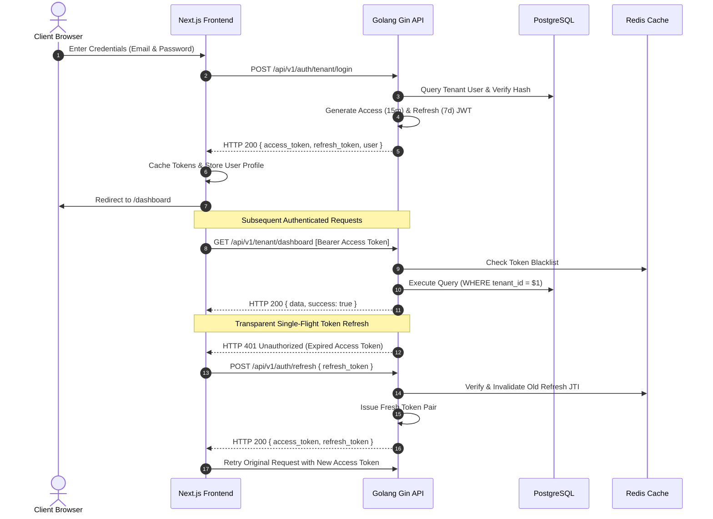

# Vyavsa Authentication Flow & Session Management

## 1. Overview
Authentication in Vyavsa separates platform administrators from tenant organization users while maintaining a unified JWT infrastructure backed by PostgreSQL and Redis.



---

## 2. Token Lifecycle & Specifications

### 2.1 Access Token
- **Format**: HMAC-SHA256 Signed JWT (`HS256`).
- **Validity**: 15 minutes (`JWT_ACCESS_EXPIRY=15m`).
- **Payload Claims**:
  ```json
  {
    "user_id": "18c21a41-b0e2-4f76-90f7-ebf4244d2149",
    "tenant_id": "87e35b01-f92e-4361-bd38-16e788bc5912",
    "email": "owner@omsupermarket.com",
    "role": "admin",
    "user_type": "tenant_user",
    "token_type": "access",
    "jti": "5a4f78de-07a8-4c07-b714-d841b8021c56",
    "iss": "vyavsa-bill-book",
    "exp": 1793779800
  }
  ```

### 2.2 Refresh Token
- **Format**: HMAC-SHA256 Signed JWT.
- **Validity**: 7 days (`JWT_REFRESH_EXPIRY=168h`).
- **Rotation Behavior**: Each call to `/api/v1/auth/refresh` invalidates the submitted refresh token in Redis and issues an entirely new token pair.

---

## 3. Password Recovery & OTP Verification Flow

1. **Step 1 (`POST /api/v1/auth/forgot-password`)**:
   - User inputs registered email.
   - Backend generates a 6-digit numeric OTP (expiry: 5 minutes), stores hash in Redis, and asynchronously queues email delivery via worker.
   - Client redirects to `/verify-otp?email=...`.

2. **Step 2 (`POST /api/v1/auth/verify-reset-otp`)**:
   - User inputs 6-digit OTP.
   - Backend verifies OTP against Redis attempt limit (max 5 attempts).
   - Upon success, backend issues a dedicated short-lived `reset_token` (purpose: `password_reset`, expiry: 10 minutes).
   - Frontend caches `reset_token` in `sessionStorage` and redirects to `/reset-password`.

3. **Step 3 (`POST /api/v1/auth/reset-password`)**:
   - User enters and confirms new password.
   - Backend validates `reset_token`, hashes password with bcrypt, updates user table, and records user-wide token invalidation timestamp in Redis to immediately revoke all existing sessions.
   - Frontend clears `reset_token` and redirects to `/login`.
